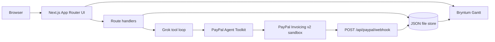

# Zilla Milestones

Zilla Milestones by Zilla Labs turns a plain-text project scope into payment-gated phases. An AI agent prices and sequences the work, a Bryntum Gantt chart shows each phase, and PayPal sandbox invoices unlock the next phase when they are paid. If an invoice sits past its due date, downstream bars move later and the agent drafts a client update for a person to approve. The draft is never sent on its own.

Built for the PayPal AI Hackathon. Stage 1 is the deliverable set in this repo. Stage 2 weights Technological Implementation equally with the other criteria, and ties break on that criterion. The Bryntum Gantt chart is the schedule surface for the Bryntum sponsor prize.

## What it does

1. You paste a scope, a client billing email, and a budget.
2. Grok (or the canned demo planner) returns phases with durations, dependencies, and dollar amounts. The JSON is checked with a Zod schema before anything is saved.
3. Phases render in a Bryntum Gantt chart. Each bar is colored by payment status: Draft, Invoiced, Paid, or Overdue.
4. **Invoice phase** creates and sends a PayPal invoice through the official PayPal Agent Toolkit.
5. A webhook, a **Sync status** button, or **Simulate payment** marks the phase paid and unlocks dependents.
6. An overdue invoice shifts dependent phases to the right and drafts a client email. Approval copies the draft. It does not send mail.
7. The chat panel can invoice a phase, list what is unpaid, or push a milestone back. Those actions go through tools, including the PayPal toolkit tools when sandbox keys are set.

A PYUSD checkbox adds a PayPal USD note on the invoice. The charge itself stays a normal PayPal invoice.

## How PayPal is used

Sandbox base URL: `https://api-m.sandbox.paypal.com` when `PAYPAL_MODE` is not `live`.

The agent and the buttons call the [PayPal Agent Toolkit](https://www.npmjs.com/package/@paypal/agent-toolkit) (`@paypal/agent-toolkit/openai`). Enabled toolkit tools:

| Toolkit tool | PayPal API | Role |
| --- | --- | --- |
| `create_invoice` | `POST /v2/invoicing/invoices` | Draft a milestone invoice for the phase amount and billing email |
| `send_invoice` | `POST /v2/invoicing/invoices/{id}/send` | Email the invoice to the client from the sandbox business account |
| `get_invoice` | `GET /v2/invoicing/invoices/{id}` | Sync one invoice onto the Gantt |
| `list_invoices` | `GET /v2/invoicing/invoices` | Available to the chat agent |
| `record_payment_for_invoice` | `POST /v2/invoicing/invoices/{id}/payments` | **Simulate payment**. Method is `OTHER` so the sandbox call does not need a capture id |
| `send_invoice_reminder` | `POST /v2/invoicing/invoices/{id}/remind` | Available to the chat agent |

OAuth (`POST /v1/oauth2/token`) is handled inside the toolkit. Webhook verification calls `POST /v1/notifications/verify-webhook-signature` with `PAYPAL_WEBHOOK_ID` and the `PayPal-Transmission-*` headers.

`POST /api/paypal/webhook` accepts `INVOICING.INVOICE.PAID`, `INVOICING.INVOICE.CANCELLED`, and `INVOICING.INVOICE.REFUNDED` (plus a status on the resource such as `SENT` or `PAID`). A valid `PAID` event marks that phase paid and unblocks dependents. An invalid signature returns 401 and does not change the chart.

**Invoice phase** is the path the buttons and the `invoice_phase` agent tool use: toolkit `create_invoice`, then `send_invoice`, then the phase flips to Invoiced. The chat agent can also call the toolkit tools directly and finish with `link_paypal_invoice`.

`PAYPAL_MERCHANT_EMAIL` must be the sandbox business email that owns the REST app. PayPal rejects invoices from a different invoicer address.

## How AI is used

Planning and chat use the xAI Grok API, OpenAI-compatible, at `XAI_BASE_URL` (default `https://api.x.ai/v1`) with model `XAI_MODEL` (default `grok-4`).

- **Planner.** One chat completion asks for a JSON plan. `lib/schema.ts` parses it with Zod (`projectName`, `summary`, phases with `name`, `description`, `durationDays`, `amount`, `dependsOn`). On failure it retries once with the validation error. Amounts are then scaled so they sum to the budget. Dates are calendar days, walked in dependency order.
- **Operator agent.** A tool loop (up to six steps) gets the project snapshot plus domain tools (`invoice_phase`, `shift_phase`, `sync_invoices`, `record_sandbox_payment`, `check_overdue`, `draft_client_update`, `link_paypal_invoice`, `get_project_state`) and the PayPal toolkit tools listed above. Mutations happen only through those tools.

`DEMO_MODE=true`, or a missing key when `DEMO_MODE` is unset, uses a fixed four-phase plan (Discovery, Design, Build, Launch) and a small intent parser that calls the same invoice, shift, sync, and overdue functions. `DEMO_MODE=false` refuses to fall back and requires the keys.

## Bryntum Gantt

The chart is Bryntum Gantt 7.3.8 from the public trial package. It is installed with npm aliasing so imports stay `@bryntum/gantt`:

```json
"@bryntum/gantt": "npm:@bryntum/gantt-trial@7.3.8"
```

That package is commercial evaluation software shipped by Bryntum. It is not covered by this repo's MIT license. The trial build is not minified and may show Bryntum's trial watermark. Do not remove the watermark. A production deployment needs a Bryntum license; switch the alias to the licensed package and keep the same imports. See the [Bryntum npm guide](https://bryntum.com/products/gantt/docs/guide/Gantt/npm-repository).

The React wrapper `@bryntum/gantt-react` is not on the public registry. The UI mounts `Gantt` from `@bryntum/gantt` in a client component, with `gantt.css`, the Stockholm Dark theme, and the bundled Font Awesome CSS. Tasks are `manuallyScheduled` so the dates produced by our dependency logic stay put. Dependency arrows still draw. Payment status is a task field, a column, and a bar color (Draft slate, Invoiced gold, Paid green, Overdue red). Dragging and editing inside the grid are off so the chart stays aligned with the store.

## Architecture



Phases, drafts, and chat live in `data/store.json` (or `ZILLA_STORE_PATH`). On Vercel the file is `/tmp/zilla-milestones.json`. That disk is local to one instance and disappears on a cold start, so the hackathon demo is meant to run locally. There is no external database.

## Setup

Requirements: Node.js 20 or newer.

```bash
cp .env.example .env.local
npm ci
npm test
npm run lint
npm run dev
```

Open http://localhost:3000.

### Environment variables

| Variable | Required | Purpose |
| --- | --- | --- |
| `DEMO_MODE` | no | `true` forces canned AI and mocked PayPal. `false` requires real keys. Unset uses real services when their keys exist |
| `XAI_API_KEY` | for live Grok | xAI API key |
| `XAI_MODEL` | no | Default `grok-4` |
| `XAI_BASE_URL` | no | Default `https://api.x.ai/v1` |
| `PAYPAL_CLIENT_ID` | for live sandbox | Sandbox REST app client id |
| `PAYPAL_CLIENT_SECRET` | for live sandbox | Sandbox REST app secret |
| `PAYPAL_MODE` | no | `sandbox` (default) or `live` |
| `PAYPAL_MERCHANT_EMAIL` | for live invoices | Sandbox business email that owns the app |
| `PAYPAL_MERCHANT_NAME` | no | Default `Zilla Labs` |
| `PAYPAL_WEBHOOK_ID` | for live webhook verification | Webhook id from the PayPal dashboard |
| `ZILLA_STORE_PATH` | no | Override the JSON store path |

Never commit `.env.local`. Only `.env.example` is in git.

PayPal app setup: create a sandbox REST app, copy the client id and secret, and set the merchant email to that business account. For webhooks, subscribe the app to `INVOICING.INVOICE.PAID`, `INVOICING.INVOICE.CANCELLED`, and `INVOICING.INVOICE.REFUNDED`, then point the listener at `https://<public-host>/api/paypal/webhook`. The demo does not need a public URL: use **Sync status** or **Simulate payment**.

In demo mode, a webhook is accepted only with header `x-zilla-demo-signature: demo`.

## Testing for judges

```bash
npm ci
npm test
npm run lint
npm run build
```

Unit tests (Vitest):

- `tests/schema.test.ts` — Zod plan schema, fenced JSON, and the canned plan scaled to the budget
- `tests/schedule.test.ts` — dependency shift when an invoice is overdue, no double shift, paid tasks stay put, unlock on payment, cycle rejection
- `tests/webhook.test.ts` — handler with signature verification mocked, plus the PayPal verify call with `fetch` mocked

No keys are required for the tests or for `DEMO_MODE=true`.

## Demo script

Leave keys empty, or set `DEMO_MODE=true`, then `npm run dev`.

1. The sample scope is already filled. Billing email `billing@example.com`, budget `12000`. Leave **Note PYUSD** on if you want the invoice note. Click **Build milestone plan**.
2. The Bryntum Gantt shows Discovery, Design, Build, and Launch. Discovery is Draft and unlocked. The others are blocked.
3. With Discovery selected, click **Invoice phase**. The bar turns Invoiced (gold) and a PayPal invoice id appears. In sandbox mode this is a real invoice email to the billing address. In demo mode the id looks like `INV2-DEMO-...`.
4. Click **Simulate payment**. Discovery turns Paid (green) and Design unlocks.
5. Select Design, **Invoice phase**, then **Simulate overdue**. Design turns Overdue (red). Build and Launch move later. A client update appears and says it has not been sent. **Approve and copy** only copies it. **Discard** drops it.
6. In the agent panel, try `What's unpaid?`, `Invoice phase 1` (already paid, so it should say so), and `Push design back a week`.
7. **Sync status** re-reads invoice state. **Check overdue** runs the same rule without forcing a due date.
8. Optional webhook, demo mode:

```bash
curl -s -X POST http://localhost:3000/api/paypal/webhook \
  -H 'content-type: application/json' \
  -H 'x-zilla-demo-signature: demo' \
  -d '{"event_type":"INVOICING.INVOICE.PAID","resource":{"id":"INV2-DEMO-REPLACE","status":"PAID"}}'
```

Replace the id with the invoice id shown on the phase card, then reload. An unsigned POST returns 401.

**New plan** clears the JSON store.

## Project layout

- `app/` — App Router UI and route handlers
- `components/GanttPanel.tsx` — Bryntum Gantt mount
- `lib/schema.ts` — Zod plan
- `lib/schedule.ts` — dates, blocks, manual shifts
- `lib/overdue.ts` — overdue slip and email draft
- `lib/paypal.ts` — toolkit calls and the demo PayPal mock
- `lib/agent.ts` — Grok tool loop and demo intents
- `lib/webhook.ts` — signature verification and event application
- `tests/` — Vitest

## License

Application code is MIT. See `LICENSE`.

Bryntum Gantt trial (`@bryntum/gantt-trial`) is Bryntum commercial evaluation software and stays under Bryntum's terms. PayPal Agent Toolkit is under its own license as published on npm.
