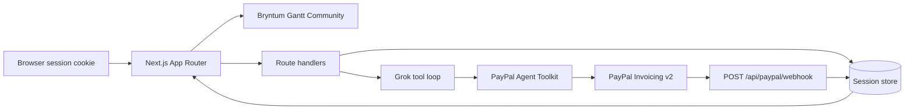

# Zilla OS / Milestones

Get paid before the next phase starts.

Zilla Milestones is a module of Zilla OS, an operating system for running a company. Paste a scope, a client billing email, and a budget. Grok breaks the work into priced phases. A Bryntum Gantt chart treats every phase as a payment gate. PayPal invoices collect the money, and the next phase stays locked until the invoice is paid. If a payment goes past its Net-7 due date, the agent moves the downstream work and drafts a client update. A person approves before any reminder goes out.

Demo: https://milestones.zillalabs.ai

Video: _(YouTube link goes here after recording)_

Repo: https://github.com/AL-ZiLLA/zilla-milestones

## 60-second judge path

No keys required. `DEMO_MODE=true` (or simply omit the keys) runs the whole story.

```bash
npm ci
npm run dev
```

Open http://localhost:3000. The first visit seeds an HVAC booking portal ($18,000) for your browser session. Another visitor gets a different session and cannot overwrite yours.

1. The Gantt shows Discovery, Design, Build, and Launch. Discovery is open. Later phases show a padlock until the previous invoice is paid. Diamonds between the bars are payment gates.
2. With Discovery selected, click **Invoice phase**. The bar turns Invoiced. **Open PayPal invoice** is the payer link (a real sandbox invoice when PayPal keys are set; a mock id in demo mode).
3. Open **Demo controls** and click **Simulate payment**, or pay the real invoice and wait for the toast `PayPal webhook verified: INVOICING.INVOICE.PAID`. The page updates without a reload. Design unlocks.
4. Invoice Design, then **Fast-forward past due**. The demo clock jumps seven days past the Net-7 due date. Design turns Overdue, later bars move right, and **At risk** updates. The due date itself is not backdated.
5. Read the approval card. Click **Approve** to send a PayPal reminder (`send_invoice_reminder`). **Discard** sends nothing.
6. In the agent box, ask `What's unpaid?` or `Push design back a week`.

**New plan** clears the session and shows sample scopes (HVAC booking portal, Harbor & Pine). **Sync from PayPal** re-reads invoice status if a webhook is missed.

## How the agent is gated

Money and client messages do not go out on their own.

| Step | Who starts it | What actually runs |
| --- | --- | --- |
| Plan | **Build milestone plan** | Grok returns JSON. Zod checks it. Amounts are scaled to the budget. One repair retry. |
| Invoice | **Invoice phase**, or a chat request to invoice | Toolkit `create_invoice`, then `send_invoice` |
| Pay | Buyer on the PayPal invoice, or **Simulate payment** inside Demo controls | Verified `INVOICING.INVOICE.PAID` webhook, or toolkit `record_payment_for_invoice` |
| Late payment | Demo clock or the real merchant date passing the due date | Schedule shift and a drafted client update. Nothing is sent. |
| Reminder | **Approve** on the card | Toolkit `send_invoice_reminder` only. The chat agent cannot send it. |

The agent actions panel lists each tool call in order with the PayPal API name, status, and latency. Client update copy is written by Grok when `XAI_API_KEY` is set and `DEMO_MODE` is not forcing the canned planner. The template in `lib/email.ts` is the fallback, and a draft is kept only if it cites the amount, the due date, and the schedule impact.

## Architecture



The store is one project per visitor session. Set `SUPABASE_URL` and `SUPABASE_SERVICE_ROLE_KEY` to use Postgres (`supabase/migrations/20261111000000_zilla_sessions.sql`, one row per session). Otherwise the app uses a JSON file: `data/store.json` locally, or `/tmp/zilla-milestones.json` on Vercel when `ZILLA_STORE_PATH` is unset. The webhook has no browser cookie. It finds the session by PayPal invoice id.

`vercel.json` raises the API route limit to 60 seconds so a Grok plan can finish. This repo does not deploy itself.

## PayPal

Sandbox base URL: `https://api-m.sandbox.paypal.com` unless `PAYPAL_MODE=live`.

| Toolkit tool | PayPal API | Role |
| --- | --- | --- |
| `create_invoice` | `POST /v2/invoicing/invoices` | Draft the phase invoice. `invoice_date` is the merchant date in America/Los_Angeles, never UTC today |
| `set_invoice_due_date` | `PUT /v2/invoicing/invoices/{id}` | Before send, set `payment_term` to `DUE_ON_DATE_SPECIFIED` with due = invoice date + 7. The toolkit create schema has no due-date field, and PayPal has no `NET_7` term. A rejected update does not block send; the invoice note still states Net 7 |
| `send_invoice` | `POST /v2/invoicing/invoices/{id}/send` | Email the invoice |
| `get_invoice` | `GET /v2/invoicing/invoices/{id}` | Read status and the payer-view link. **Sync from PayPal** uses this |
| `list_invoices` | `GET /v2/invoicing/invoices` | Available to the chat agent |
| `record_payment_for_invoice` | `POST /v2/invoicing/invoices/{id}/payments` | Demo-controls simulate payment. Method `OTHER` |
| `send_invoice_reminder` | `POST /v2/invoicing/invoices/{id}/remind` | Sent only from **Approve** |

OAuth stays inside the toolkit. Webhook verification calls `POST /v1/notifications/verify-webhook-signature` with `PAYPAL_WEBHOOK_ID`. A bad signature returns 401 and does not change the chart. A verified `INVOICING.INVOICE.PAID` marks the phase paid, unlocks dependents, and the open page toasts `PayPal webhook verified: INVOICING.INVOICE.PAID`.

`PAYPAL_MERCHANT_EMAIL` must be the sandbox business email that owns the REST app.

In demo mode, a webhook is accepted only with header `x-zilla-demo-signature: demo`.

## AI

Planning and chat use xAI Grok at `XAI_BASE_URL` (default `https://api.x.ai/v1`) with `XAI_MODEL` (default `grok-4`).

- **Planner.** One completion returns JSON. `lib/schema.ts` checks it. On failure it retries once with the validation error.
- **Operator.** A tool loop (up to six steps) uses domain tools plus the PayPal toolkit tools. State changes go through tools.
- **Client update.** Grok writes the overdue note. The template is used when there is no key, when demo mode is on, or when the model omits the amount, due date, or schedule impact.

`DEMO_MODE=true`, or a missing key when `DEMO_MODE` is unset, uses a fixed four-phase plan and a small intent parser that calls the same functions. `DEMO_MODE=false` does not fall back.

## Bryntum Gantt

The chart is Bryntum Gantt Community 8.0.0 (`@bryntum/gantt-community`), MIT licensed. It replaces the earlier trial package, so the chart does not show a trial watermark. Font Awesome comes from `@bryntum/core-community` at the same version. The React wrapper is not required: a client component mounts `Gantt` with `gantt.css` and the Stockholm Dark theme.

Tasks are `manuallyScheduled` on a 7-day calendar so our dates stay put. The view preset is week-and-month, and the tick size is fitted to the project span so every bar and month label stays inside the timeline at 1280, 1440, and 1920. Status toasts sit in the header between the product name and the legend. When a tick would be narrower than 64px, the week header drops to the day number so labels do not overlap. Start and finish columns use a short date such as Mar 22. A later year shows as Mar 22 '27, and the full date is on the cell tooltip. The milestone column fits a name like Launch and Handoff at 1280, 1440, and 1920, and a 4–5 phase plan shows every row without scrolling the chart. Bar color follows payment state (Draft, Invoiced, Paid, Overdue) with a progress fill. A duration-zero diamond sits on each dependency as a payment gate. Downstream rows show a padlock until the upstream phase is paid.

Community does not include the Business/Enterprise features (full task editor, baselines, progress line, PDF export). Those are left off.

## Environment

| Variable | Required | Purpose |
| --- | --- | --- |
| `DEMO_MODE` | no | `true` forces canned AI and mocked PayPal. `false` requires real keys. Unset uses real services when their keys exist |
| `XAI_API_KEY` | for live Grok | xAI API key |
| `XAI_MODEL` | no | Default `grok-4` |
| `XAI_BASE_URL` | no | Default `https://api.x.ai/v1` |
| `PAYPAL_CLIENT_ID` | for live sandbox | Sandbox REST app client id |
| `PAYPAL_CLIENT_SECRET` | for live sandbox | Sandbox REST app secret |
| `PAYPAL_WEBHOOK_ID` | for live webhook verification | Webhook id from the PayPal dashboard |
| `PAYPAL_MODE` | no | `sandbox` (default) or `live` |
| `PAYPAL_MERCHANT_EMAIL` | for live invoices | Sandbox business email that owns the app |
| `PAYPAL_MERCHANT_NAME` | no | Default `Zilla Labs` |
| `SUPABASE_URL` | for hosted sessions | Supabase project URL |
| `SUPABASE_SERVICE_ROLE_KEY` | for hosted sessions | Server-only service role key. Never expose it to the browser |
| `ZILLA_STORE_PATH` | no | JSON file path when Supabase is not set |
| `NEXT_PUBLIC_SITE_URL` | no | Public origin for canonical and Open Graph URLs. Defaults to `https://milestones.zillalabs.ai` |

Never commit `.env.local` or a service role key. Only `.env.example` is in git.

Apply `supabase/migrations/20261111000000_zilla_sessions.sql` before pointing the app at Supabase. Subscribe the PayPal app to `INVOICING.INVOICE.PAID`, `INVOICING.INVOICE.CANCELLED`, and `INVOICING.INVOICE.REFUNDED`, and set the listener to `https://milestones.zillalabs.ai/api/paypal/webhook`.

## Run

Node.js 20 or newer.

```bash
cp .env.example .env.local
npm ci
npm test
npm run lint
npm run build
npm run dev
```

Open http://localhost:3000.

```bash
npm test
npm run lint
npm run build
```

Vitest covers the plan schema, the overdue engine, webhook signature verification and unlock, merchant-local invoice dates, Net-7 due dates, the approval gate, and session isolation. No keys are required. `DEMO_MODE=true` runs the story end to end.

Optional demo webhook, after an invoice id exists in your session:

```bash
curl -s -X POST http://localhost:3000/api/paypal/webhook \
  -H 'content-type: application/json' \
  -H 'x-zilla-demo-signature: demo' \
  -d '{"event_type":"INVOICING.INVOICE.PAID","resource":{"id":"INV2-DEMO-REPLACE","status":"PAID"}}'
```

Replace the id with the invoice id on the phase. The open page picks it up on its own. An unsigned POST returns 401.

## Install

The canonical app is [https://milestones.zillalabs.ai](https://milestones.zillalabs.ai). Chrome, Edge, and other Chromium browsers can install it as a standalone app. The service worker caches the static shell (icons, hashed `/_next/static` files) so repeat visits open quickly, and it serves `offline.html` when a navigation cannot reach the network. Requests to `/api/*`, including chat and `POST /api/paypal/webhook`, are network-only and are never written to the cache. `NEXT_PUBLIC_SITE_URL` still overrides the public origin when it is set. The env var name is unchanged.

## Layout

- `app/` — App Router UI, web app manifest, Open Graph image, and route handlers
- `public/icons/` — 192, 512, maskable 512, and apple-touch-icon, plus `favicon.ico` and `icon.svg`
- `public/sw.js` — app-shell cache. `/api/*` stays on the network
- `components/GanttPanel.tsx` — Bryntum Gantt Community mount
- `lib/invoice-payload.ts` — merchant invoice date and Net-7 body
- `lib/store.ts` — file store and Supabase store
- `lib/compose.ts` — Grok client update, with the template fallback
- `supabase/migrations/20261111000000_zilla_sessions.sql` — session table

## License

Application code is MIT. See `LICENSE`.

Bryntum Gantt Community (`@bryntum/gantt-community` 8.0.0) and `@bryntum/core-community` 8.0.0 are MIT, copyright 2009–2026 Bryntum AB. PayPal Agent Toolkit is under its own license as published on npm.
